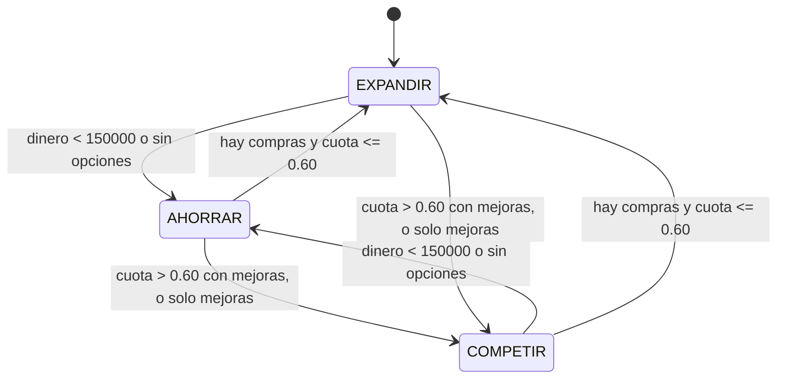

# Instituto Rival controlado por IA

## Resumen

El Instituto Rival es una escuela competidora que compra y mejora edificios del mismo mapa que el jugador. Su comportamiento lo decide una máquina de estados finita de **gdx-ai** (`DefaultStateMachine`), evaluada una vez por ciclo de juego (30 s). Es una IA de juego determinista y local: no usa red, servicios externos ni claves de API.

Código principal:

- `core/.../rival/MercadoAlumnos.kt`: modelo de mercado (poder, cuota, factor de atracción).
- `core/.../rival/RivalAgent.kt` y `RivalEstado.kt`: agente y estados.
- `core/.../rival/RivalState.kt`: estado global y serialización.
- `core/.../rival/ReglaFinPartida.kt`: victoria y derrota.
- `core/.../engine/RivalEngine.kt`: integración con el ciclo.

## Modelo de mercado

Para cada escuela, el **poder** es la suma de `baseAlumnos * nivel` de sus edificios.

```
poderJ = Σ baseAlumnos * nivel   (edificios comprados por el jugador)
poderR = Σ baseAlumnos * nivel   (edificios en RivalState.edificios)

cuotaJugador    = poderJ / (poderJ + poderR)      (0.5 si ambos son 0)
factorAtraccion = clamp(0.75 + 0.5 * cuota, 0.75, 1.25)
```

El factor del jugador usa `cuotaJugador`; el del rival usa `1 - cuotaJugador`. Con cuota 0 el factor es 0.75 y con cuota 1 es 1.25. Si el rival no tiene edificios y el jugador sí, la cuota es 1.0 (bonus de monopolio).

| Magnitud | Fórmula |
|---|---|
| Alumnos del jugador | `round(Σ baseAlumnos*nivel * factor(cuotaJ))` |
| Ingreso/ciclo del jugador | `round(Σ baseAlumnos*nivel*100 * factor(cuotaJ))` (`INGRESO_POR_ALUMNO = 100`) |
| Ingreso/ciclo del rival | `round(Σ baseAlumnos*nivel*100 * factor(1 - cuotaJ))` |

`EstudiantesEngine` escribe `GameState.alumnosTotales = alumnosJugador()` y `EconomyEngine` usa `ingresoJugador()`. El dinero inicial del rival es `RivalState.DINERO_INICIAL = 500_000`.

## Máquina de estados

Constantes (`RivalAgent`): `RESERVA_MINIMA = 150_000`, `UMBRAL_COMPETIR = 0.60`, `NIVEL_INICIAL = 1`, `CICLOS_GRACIA = 3`, `EDIFICIOS_PROTEGIDOS = {"escom_hitbox"}` (la escuela inicial del jugador, que el rival nunca compra).

Definiciones: *compras asequibles* son los edificios no comprados por el jugador, no poseídos por el rival, no protegidos y con `precio <= dinero` del rival. *Mejoras asequibles* son edificios del rival con `nivel < mejoraMax` y `precio * nivel <= dinero`.

Durante los ciclos `<= CICLOS_GRACIA` el agente no actúa. Después, en cada ciclo calcula el estado destino con esta prioridad (la primera condición que se cumple gana) y ejecuta la acción de ese estado:

| Prioridad | Estado destino | Condición | Acción |
|---|---|---|---|
| 1 | AHORRAR | `dinero < 150000`, o no hay compras ni mejoras asequibles | Ninguna (acumula dinero) |
| 2 | COMPETIR | `cuotaJugador > 0.60` y hay mejoras asequibles | Mejora el edificio con mayor `baseAlumnos / costo` |
| 3 | EXPANDIR | hay compras asequibles | Compra el edificio con mayor `baseAlumnos * factorRival / precio` |
| 4 | COMPETIR | solo quedan mejoras asequibles | Mejora (como en la prioridad 2) |

Costo de mejora: `precio * nivelActual`. A ambos puntajes se les aplica un ruido aleatorio de hasta 2 % para desempatar. Cada transición se informa como `RivalAccion.CambioEstado`.



## Integración

- `ResolutionOrder.RIVAL` es la cuarta etapa del ciclo: `ECONOMY`, `CONSTRUCTION`, `STUDENTS`, **`RIVAL`**, `REPUTATION`, `EVENTS`. Corre después de `STUDENTS`, por lo que ve alumnos y poder ya actualizados.
- `RivalEngine.onResolveCycle`: (1) suma `ingresoRival()` al dinero del rival, (2) `agent.tomarTurno(ciclo)`, (3) `ReglaFinPartida.evaluar`. El ciclo se toma de `GameState.ciclosJugados`, porque el contador del motor no se reinicia entre partidas.
- Callbacks en `GameScreen`: `onAccion` registra en logcat (etiqueta `RIVAL`), muestra un toast ("Instituto Rival compró/mejoró: ...") y marca el HUD como sucio; `onFinPartida` abre `FinPartidaWindow`.
- HUD: etiqueta "Tú X% | Rival Y%" (color salmón). Se reinicia `lastCuota` al entrar a la pantalla para forzar el redibujado.
- Mapa: los edificios del rival se dibujan con tinte rojo (`setColor(1, 0.55, 0.55, 1)`) y la textura según su nivel.
- Bloqueo de compra: los edificios del rival no son clicables para comprar; `BuildingInfoWindow` muestra "Propiedad del Instituto Rival (Nivel N)" sin botón. Si el rival lo compra con la ventana abierta, el botón pasa a "Propiedad del rival" y se deshabilita.
- Nueva partida: `RivalState.reset()` en `SeleccionPartida` y `PartidasGuardadas`.

## Fin de partida

Reglas de `ReglaFinPartida` (solo desde el ciclo 10, `CICLO_MINIMO`):

- **Victoria**: `cuotaJugador >= 0.70` durante 3 ciclos consecutivos.
- **Derrota**: `cuotaJugador <= 0.25` durante 3 ciclos consecutivos.
- Los contadores `ciclosVictoria` y `ciclosDerrota` se reinician a 0 si la condición se rompe.
- El resultado se informa **una sola vez por partida** (`finPartidaMostrado`, que también se guarda).
- `FinPartidaWindow` ofrece "Continuar jugando" (cierra el diálogo) y "Menú".

## Persistencia

- Columna nueva `rivalJson TEXT NOT NULL DEFAULT ''` en la tabla `escuelas` (`EscuelaEntity`).
- `AppDatabase` pasa a la versión 5 con `MIGRATION_4_5` (`ALTER TABLE ... ADD COLUMN`), registrada en `DatabaseProvider`. Los datos existentes se conservan.
- Formato de `RivalState.serializar()`: `dinero|ESTADO|ciclosVictoria|ciclosDerrota|fin|id:nivel,id:nivel` (`fin` es 0 o 1). Ejemplo: `120000|AHORRAR|0|0|0|Edificio2:1,Mac_and_cheese:2`.
- `deserializar` nunca lanza: una cadena vacía, corrupta, con valores negativos o con nivel menor que 1 deja el rival en `reset()`.
- Partidas guardadas antes de la versión 5 cargan con `rivalJson = ''`, es decir, un rival nuevo.
- `AndroidGameSaveManager` guarda con `RivalState.serializar()` y carga con `RivalState.deserializar(...)`.

## Pruebas automatizadas

`./gradlew :core:test` ejecuta **54 pruebas, 0 fallos, 0 omitidas**, en 9 clases:

| Clase | Pruebas |
|---|---|
| `rival.MercadoAlumnosTest` | 7 |
| `rival.RivalAgentTest` | 8 |
| `rival.RivalEstadoTest` | 7 |
| `rival.ReglaFinPartidaTest` | 5 |
| `rival.RivalSerializacionTest` | 5 |
| `engine.RivalEngineTest` | 4 |
| `engine.GameCycleEngineTest` | 3 |
| `engine.PipelineCompletoTest` | 2 |
| `GameStateTest` | 3 |

## QA manual en dispositivo

Dispositivo Xiaomi 25062PC34G, Android 16, APK debug `versionName 1.3.1`, 2026-11-06. Registro completo: [`qa-rival-logcat-completo.txt`](evidencia/rival-ia/qa-rival-logcat-completo.txt).

| ID | Caso | Resultado | Evidencia |
|---|---|---|---|
| CP-R1 | Partida nueva: el HUD muestra "Tú X% \| Rival Y%" y el rival compra tras el periodo de gracia (log: `Compra Edificio2 por 400000`). | PASS | [captura](evidencia/rival-ia/cp1-cp2-hud-cuota-y-edificio-rival.png) |
| CP-R2 | El edificio del rival se ve en rojo y su ventana dice "Propiedad del Instituto Rival (Nivel 1)" sin botón de compra. | PASS | [mapa](evidencia/rival-ia/cp1-cp2-hud-cuota-y-edificio-rival.png), [ventana](evidencia/rival-ia/cp2-ventana-propiedad-rival.png) |
| CP-R3 | Al superar 60 % de cuota el rival pasa a COMPETIR y mejora (log: `AHORRAR -> COMPETIR`, `Mejora Mac_and_cheese a nivel 2`). | PASS | [log](evidencia/rival-ia/qa-rival-logcat-completo.txt) |
| CP-R4 | Guardar, salir y cargar conserva los edificios del rival (migración 4→5 sin pérdida). | PASS | [log](evidencia/rival-ia/qa-rival-logcat-completo.txt) |
| CP-R5 | Victoria tras el ciclo 10 con 98 % (log: `Fin de partida: VICTORIA`); "Continuar jugando" cierra el diálogo y no reaparece. | PASS | [dominio](evidencia/rival-ia/cp5-dominio-99-vs-1.png), [diálogo](evidencia/rival-ia/cp5-dialogo-victoria.png), [log](evidencia/rival-ia/qa-rival-logcat-completo.txt) |

Nota sobre CP-R5: para acelerarlo se usó una compilación local temporal que iniciaba con 100 M (`DINERO_INICIAL_TEST`). Ese cambio no se incluyó en ningún commit.

### Defecto encontrado y corregido

Al volver a entrar a `GameScreen` (por ejemplo, tras cargar una partida) la etiqueta de cuota quedaba vacía hasta que cambiaba el valor, porque `lastCuota` conservaba el valor anterior. Se corrigió en el commit `a518a2b`, que reinicia `lastCuota = -1` al configurar los controles. Captura previa a la corrección: [bug-hud-cuota-vacia-antes-del-fix.png](evidencia/rival-ia/bug-hud-cuota-vacia-antes-del-fix.png).

### Balance simulado

Con un agente determinista (`Random(42)`) y 30 ciclos se compararon dos estrategias de jugador:

| Jugador | Cuota final | Rival al ciclo 30 | Duración |
|---|---|---|---|
| Compra un edificio cada ciclo (óptimo) | 87 % | `Edificio2` nivel 1 (poder 250) | victoria ≈ ciclo 10 |
| Compra cada 4 ciclos (casual) | 77 % | `cafeteria` nivel 2 + `Edificio2` nivel 1 (poder 450) | victoria ≈ ciclo 25 |

El rival compra, cambia a COMPETIR y mejora cuando la cuota del jugador supera
0.60. **No se cambiaron las constantes**: el rango de 10–25 ciclos se considera
razonable y el ajuste fino requiere playtesting humano con testers.

## Limitaciones conocidas

- El título del diálogo de victoria se ve como "Victoria!" sin el signo "¡": la fuente bitmap no incluye ese glifo. **En corrección** en la rama del issue #11.
- El balance del rival se validó por simulación (ver arriba); falta playtesting humano con los testers de la prueba cerrada.
- `StatsWindow` (menú de pausa) **no** aplica el factor de atracción ni el rival: calcula alumnos como `Σ baseAlumnos*nivel` e ingresos como `alumnos * 100`. Está asignado a la contribución de Javier.
- `DatabaseTest` instrumentado (`android/src/androidTest/.../DatabaseTest.kt`) ya estaba desactualizado antes de esta función. Está asignado a la contribución de Javier.

## Cómo probar

```bash
./gradlew :core:test
./gradlew :android:assembleDebug
adb install -r android/build/outputs/apk/debug/android-debug.apk
adb logcat -s RIVAL
```

(Ajustar el nombre del APK si `assembleDebug` genera otro en `android/build/outputs/apk/debug/`.)
